# UML Architecture & Class Diagrams — BloodConnect

This document provides a valid Mermaid class diagram representing the core domain models and design pattern architectures implemented in BloodConnect.

## Mermaid Class Diagram

```mermaid
classDiagram
    direction TB

    %% ==========================================
    %% DOMAIN MODELS
    %% ==========================================
    class User {
        +ObjectId _id
        +string name
        +string email
        +string password
        +string role
        +string bloodGroup
        +string location
        +boolean availableToDonate
        +Date createdAt
        +Date updatedAt
    }

    class BloodRequest {
        +ObjectId _id
        +ObjectId patientId
        +string bloodGroup
        +number units
        +string location
        +string contactDetails
        +string status
        +Date createdAt
        +Date updatedAt
    }

    BloodRequest --> User : "patientId references"

    %% ==========================================
    %% PATTERN 1: FACTORY PATTERN (Creational)
    %% ==========================================
    class AppNotification {
        <<interface>>
        +string id
        +string type
        +string title
        +string message
        +string requestId
        +string recipientEmail
        +Date createdAt
    }

    class ApprovalNotification {
        +string id
        +string type = "APPROVAL"
        +string title
        +string message
        +string requestId
        +string recipientEmail
        +Date createdAt
    }

    class RejectionNotification {
        +string id
        +string type = "REJECTION"
        +string title
        +string message
        +string requestId
        +string recipientEmail
        +Date createdAt
    }

    class FulfillmentNotification {
        +string id
        +string type = "FULFILLMENT"
        +string title
        +string message
        +string requestId
        +string recipientEmail
        +Date createdAt
    }

    class NotificationFactory {
        <<static>>
        +createNotification(payload, status) AppNotification
    }

    ApprovalNotification ..|> AppNotification : implements
    RejectionNotification ..|> AppNotification : implements
    FulfillmentNotification ..|> AppNotification : implements
    NotificationFactory ..> AppNotification : creates

    %% ==========================================
    %% PATTERN 2: ADAPTER PATTERN (Structural)
    %% ==========================================
    class IDonorSearchService {
        <<interface>>
        +search(criteria) Promise~DonorSearchResult[]~
    }

    class QueryableUserModel {
        <<interface>>
        +find(query) QueryBuilder
    }

    class DonorSearchAdapter {
        -QueryableUserModel userModel
        +search(criteria) Promise~DonorSearchResult[]~
    }

    DonorSearchAdapter ..|> IDonorSearchService : implements
    DonorSearchAdapter --> QueryableUserModel : adapts

    %% ==========================================
    %% PATTERN 3: OBSERVER PATTERN (Behavioral)
    %% ==========================================
    class StatusChangeEvent {
        +string requestId
        +string previousStatus
        +string newStatus
        +string patientId
        +string updatedBy
        +Date timestamp
    }

    class IRequestStatusListener {
        <<interface>>
        +onStatusChange(event) void
    }

    class RequestStatusSubject {
        -IRequestStatusListener[] listeners
        +subscribe(listener) void
        +unsubscribe(listener) void
        +notify(event) Promise~void~
        +getSubscriberCount() number
    }

    class AuditLogSubscriber {
        -Array logs
        +onStatusChange(event) void
        +getLogs() Array
    }

    AuditLogSubscriber ..|> IRequestStatusListener : implements
    RequestStatusSubject o--> IRequestStatusListener : notifies
    RequestStatusSubject ..> StatusChangeEvent : broadcasts
```

---

## Architectural Relationships Explained

1. **User and BloodRequest**:
   - `BloodRequest.patientId` forms a Mongoose document reference to `User._id`.
   - Patients own their respective blood requests; Admins have system-wide read/write authority.

2. **Factory Pattern Hierarchy**:
   - `AppNotification` defines the structural contract.
   - `NotificationFactory.createNotification` constructs `ApprovalNotification`, `RejectionNotification`, or `FulfillmentNotification` polymorphically depending on the updated request status.

3. **Adapter Pattern Hierarchy**:
   - `DonorSearchAdapter` encapsulates low-level MongoDB filter expressions (`role: 'DONOR'`, `$regex`, `availableToDonate: true`).
   - Callers depend strictly on `IDonorSearchService`, keeping them decoupled from Mongoose dependencies.

4. **Observer Pattern Hierarchy**:
   - `RequestStatusSubject` maintains a dynamic registry of `IRequestStatusListener` subscribers.
   - When an administrator modifies a request status, `RequestStatusSubject.notify()` broadcasts the `StatusChangeEvent` to all registered listeners such as `AuditLogSubscriber`.

